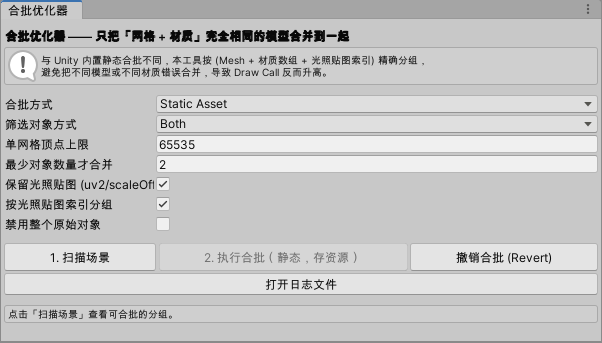

# Batch Optimizer 合批优化器



针对 Unity 内置静态合批“会把不同模型 / 不同材质错误合并、导致 Draw Call 反而升高”的问题，提供一套**精确合批**工具：
按「网格（Mesh）+ 材质数组 + 光照贴图索引」分组，只把**完全相同**的模型合并到一起。

## 功能

一个窗口，两种合批方式（顶部「合批方式」下拉勾选切换）：

1. **StaticAsset（静态合批）**：编辑器里合并，结果存成 `.asset` 资源文件，可持久化、可撤销。
2. **RuntimeMemory（运行时合批）**：Awake 时收集场景静态对象合并，纯内存、不生成资源文件。
3. **全程日志**：同时输出到 Console 与 `Logs/BatchOptimizer.log`（工程根目录），方便纠错。

## 用法

1. 打开菜单 `Tools → Batch Optimizer → 合批窗口 (Batch)`。
2. 顶部「合批方式」选择走哪套方案：
   - `StaticAsset`：编辑器合并，生成资源文件
   - `RuntimeMemory`：运行时合并，纯内存
3. 选择「筛选对象方式」：
   - `StaticFlag`：只处理勾选了 Unity 静态（Batching Static）的对象
   - `BatchTag`：只处理挂了 `Batch Tag` 组件的对象
   - `Both`（默认）：满足其一即可
4. 点击 **1. 扫描场景**，窗口列出可合批的分组与预计 Draw Call 变化。
5. 点击 **2. 执行合批**（按钮文字随方案变化）：
   - 静态：生成 `BatchOptimizer_Root`，其下是合并后的模型，网格资源存到 `Assets/BatchOptimizer/CombinedMeshes/`，原始对象的 Renderer 被禁用（默认）。
   - 运行时：创建/配置 `RuntimeBatchCombiner_Root`（`collectMode=StaticInScene`），运行时 Awake 收集场景静态对象自动合并，不挂任何组件。
6. 撤销：
   - 静态：点 **撤销合批 (Revert)**，或 `Ctrl+Z`。
   - 运行时：`Ctrl+Z`，或手动删除 `RuntimeBatchCombiner_Root`。

> 建议先在副本场景测试，确认渲染效果（尤其光照）后再用于正式场景。
> 注意：两种方案合并后，对象都作为一个整体渲染，无法再单独移动 / 隐藏；需要各自独立运动的对象请改用 GPU Instancing 或 Unity 内置动态合批。

> 组件也可独立手动使用：给父物体挂 `Runtime Batch Combiner`，`collectMode` 可选 `Children`（合并子物体）、`StaticInScene`（收集场景静态对象）或 `TaggedInScene`（收集带 BatchTag 的对象）。

## 关键参数

| 参数 | 说明 |
| --- | --- |
| 单网格顶点上限 | 超过则自动分块为多个合并网格（默认 65535） |
| 最少对象数量才合并 | 分组内对象少于该值不合并（默认 2） |
| 保留光照贴图 | 是否把每个对象的 uv2 换算到图集空间（默认开启） |
| 按光照贴图索引分组 | 不同光照贴图图集的对象不合并（默认开启） |
| 禁用整个原始对象 | true 禁用整个 GameObject，false 仅禁用 Renderer |

## 日志

- 编辑器：`<工程根目录>/Logs/BatchOptimizer.log`
- 运行时：`Application.persistentDataPath/BatchOptimizer.log`
- 日志级别可在 `BatchLogger` 上调整：`BatchLogger.MinLevel`、`EnableConsole`、`EnableFile`

## 目录结构

```
Assets/BatchOptimizer/
├── Runtime/
│   ├── BatchLogger.cs           日志工具
│   ├── BatchTag.cs              合批标记组件
│   ├── BatchCombinedResult.cs   合并结果 / 撤销记录组件
│   ├── MeshBatchCombiner.cs     核心分组与合并逻辑
│   └── RuntimeBatchCombiner.cs  运行时合批组件
├── Editor/
│   └── StaticBatchCombinerWindow.cs  静态合批编辑器窗口
├── CombinedMeshes/              静态合批生成的网格资源（自动创建）
└── README.md
```
